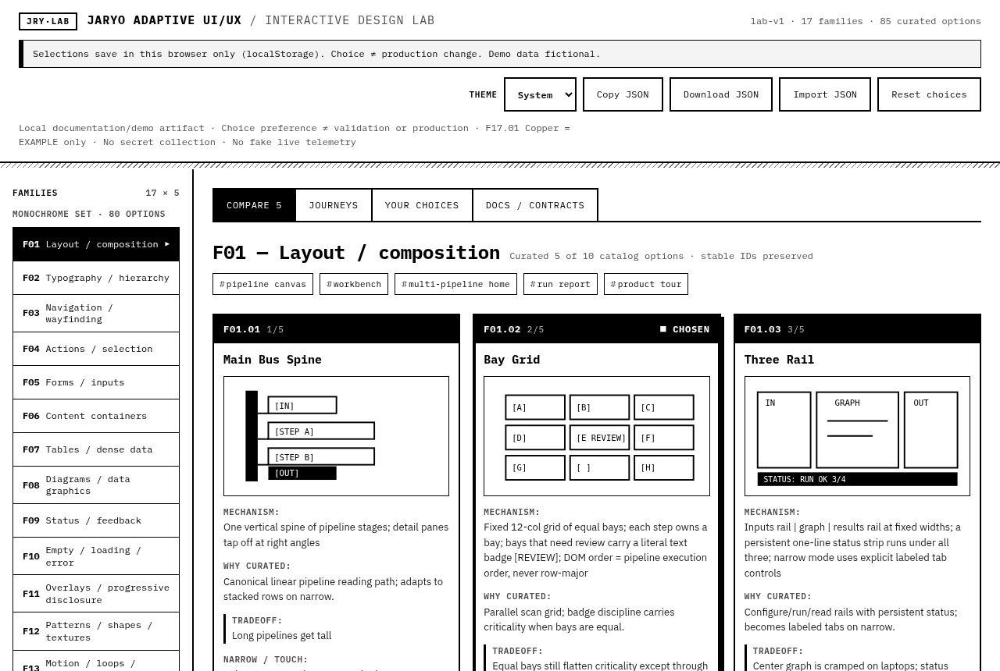
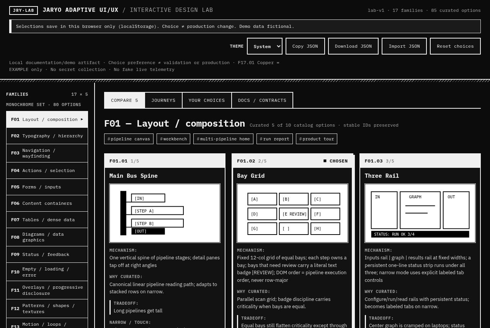
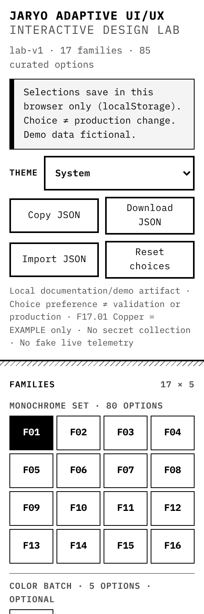

# Jaryo

Jaryo is an installable kit and a work-in-progress interface design lab for comparing layouts, typography and controls, saving choices in your browser, and exporting preferences. Its designs include monochrome, color and red-accent studies.

The lab explores interface ideas for [AGIW Suite](https://github.com/louiscalata/agiw-suite), [Old Phone OS](https://github.com/louiscalata/old-phone-os) and [Nisi](https://github.com/louiscalata/nisi); choosing an option here does not change those projects.

Live lab: [louiscalata.github.io/jaryo](https://louiscalata.github.io/jaryo/) · Project page: [fortheloveof.studio/code/jaryo](https://fortheloveof.studio/code/jaryo/)

Interface spec, reference screens, and a read-only adaptor spike: [`spec/`](spec/).

## Open the lab

```bash
git clone https://github.com/louiscalata/jaryo.git
cd jaryo
```

Open `index.html` in your browser. Embedded data loads if fetch is blocked.

## Installable kit

Jaryo is an installable kit. The canonical tokens file is `tokens/jaryo.tokens.json`. The install route is a plain read-only CLI; packaging for that route is kept with the CLI work and is not duplicated here.

Buttons keep text labels (no glyph-only buttons). Missing readings say “Not measured” (the UNKNOWN step state is unchanged). The current-page indicator default is inverted; that is a documented default, not an owner-chosen style.

## What’s in the lab

- 19 families · 85 curated + 12 optional (97 total). The 85 curated options are 80 monochrome (F01–F16) and 5 color (F17). The 12 optional options are 8 legacy studies (F18) and 4 Red interactive UI (F19).
- Theme: System / Light / Dark (persisted separately from choices)
- Shared typography tokens in `lab.css` (see [docs/TYPOGRAPHY-PRINCIPLES.md](docs/TYPOGRAPHY-PRINCIPLES.md)). Latin OFL faces load from `assets/fonts/`; licenses are in [docs/FONTS.md](docs/FONTS.md).
- Token export: `tokens/jaryo.tokens.json` (DTCG 2025.10 conformant: Design Tokens Format Module 2025.10 and Color Module 2025.10), written by `scripts/export_tokens.py` from `lab.css`. This file is the canonical tokens source. AGIW Suite kit consumption of it is Suite-side work and is not done in this repository.
- Layouts from about 260px wide to desktop
- Keyboard support for option groups and tabs (arrow keys, Home/End, Space)
- Reduced-motion support via `prefers-reduced-motion`
- Import / export of choice JSON; reset; recovery download when storage is malformed

### Families

| ID | Title | Options |
|---|---|---|
| F01–F16 | Monochrome set | 80 |
| F17 | Color systems | 5 |
| F18 | Legacy studies | 8 (optional) |
| F19 | Red interactive UI | 4 (optional) |







## Checks

```bash
python3 scripts/validate_lab.py
python3 scripts/test_validate_catalog_wording.py
python3 scripts/export_tokens.py --check
python3 scripts/test_export_tokens.py
python3 scripts/check_assets.py
node --check lab.js
node --check lab-stages.js
node scripts/test_persistence_rules.mjs
node scripts/test_smoke_cli.mjs
node scripts/test_static_server.mjs
node scripts/test_focus_coverage.mjs
node scripts/test_lab_dom.mjs
node scripts/test_ci_runners.mjs
```

The DOM check requires jsdom; see [AGENTS.md](AGENTS.md#static-and-dom-checks) for setup and spec checks.

Browser smoke and axe scripts live under `scripts/browser/` and need Playwright. Run browser checks on the hosted Linux runners; Mac checks stay browser-free (see [AGENTS.md](AGENTS.md#ci-and-browser-boundary)).

## Tested

Historical verification recorded 2026-11-09 in headless Chromium. Details: [VERIFICATION.md](VERIFICATION.md). These results do not establish a current-head pass.

- The 85 option IDs and their content are unchanged in `data/curated-85.json`.
- Extended catalog: 19 families · 85 curated + 12 optional (97 total), in `data/curated-extended.json` and `data/embedded-data.js`
- Smoke: 34/34 for legacy+typography passes; axe: 0 violations in reported modes/widths
- Package checks: `validate_lab.py`, `test_persistence_rules.mjs`, `node --check lab.js`

## Not yet tested

- Real screen readers (VoiceOver, NVDA, TalkBack)
- Real phones, cover screens, touch, OS zoom / text scaling
- Real Safari on Apple hardware: NOT_RUN.
- Firefox/WebKit engine identity and version are verified on `72f4e50` (push run `43667280382`) and PR head `d42ece7` (run `43665683075`): Playwright Firefox 132.0 and WebKit 18.2, 326/326 each (97-option click-through at 1280, 375 and 260; expanded layout also at 1920). Hosted `ubuntu-24.04` runs at #60 `3553372`, #61 `c9e56a6` and #62 `e868510` (push and pull-request each) logged the same identities, versions and 326/326 totals; see [the CI availability receipts](roadmap.md#ci-availability). That covers those heads only, and each later head needs its own run. The audited historical PC jobs logged Chromium twice; see [the browser identity correction](roadmap.md#browser-identity-correction).
- Windows forced-colors on hardware: NOT_RUN. Chromium forced-colors emulation is configured in CI and does not establish hardware results.
- Import through a real OS file picker (jsdom covers wiring)

## Known limits

- Two open tabs share one saved envelope. After another tab's storage event arrives, this tab adopts those saved choices before its next save. Each save also re-reads storage first. If another tab wrote since this tab last read it, this tab loads that write instead of overwriting it, keeps its own change on screen only, and saves it when the change is made again. Any later successful save from this tab also writes the kept change, because a save writes every displayed choice. If the other tab wrote twice before this tab's save, the storage event for its first write arrives after that save and does not match what this tab loaded, so this tab briefly shows the first write and drops its kept change; the event for the second write then loads the latest write. Nothing stored is lost, but the kept change has to be made again. An unreadable write is left in place and the banner warns that saving would overwrite it. The re-read and the write are two separate storage calls, not one atomic step, so a write from another tab that lands between them can still be overwritten. Reset is not checked this way; it clears whatever is stored.
- On narrow screens (480px and below) the full-width toast still overlaps the bottom of the screen until the next tap or key press, or for about 3 seconds. Taps pass through it, and while it shows the page reserves its height so focused controls and the end of the page can scroll clear of it. That behavior is checked in jsdom only; browser rendering of the reserved space is NOT_RUN.
- Preview mocks stay light “paper” in dark theme by design
- Text in the lab no longer sits directly on a CSS gradient: hatch strips are padded clear of their text, and the F06.08 hatched preview puts its label on a solid #000-on-#fff plate (21:1). `scripts/test_lab_visual_contract.mjs` fails on any new gradient that is not one of these two cases. This is a source check of `lab.css`, `lab-stages.css` and the lab markup, not a rendered-pixel measurement, and it does not cover `spec/`.

## License

[Apache License 2.0](LICENSE). Copyright 2026 Louis Calata. See [NOTICE](NOTICE).
