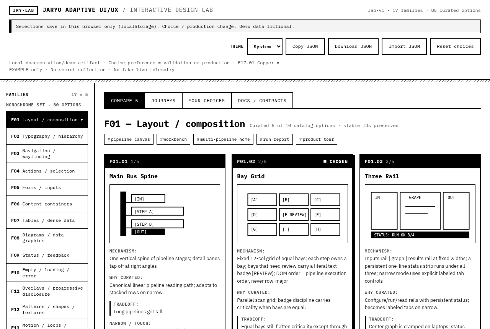
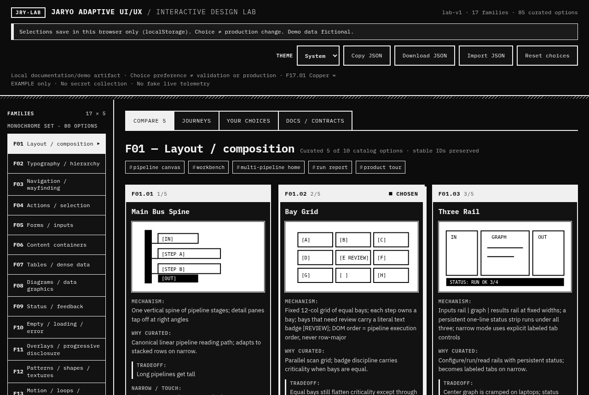
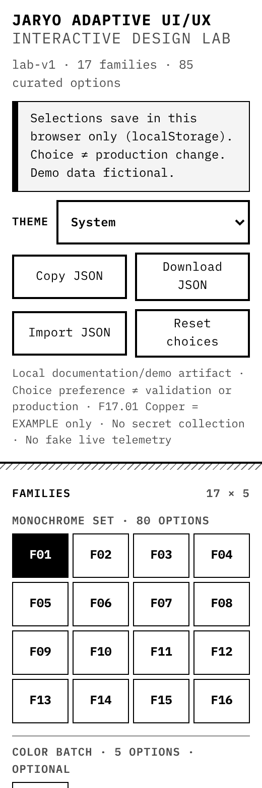

# Jaryo

Jaryo is an adaptive black-and-white design language used across [AGIW Suite](https://github.com/louiscalata/agiw-suite), [OPOS](https://github.com/louiscalata/old-phone-os), and [Nisi](https://github.com/louiscalata/nisi).

This repository is the interactive design lab: a static local page for comparing curated options, saving choices, and exporting JSON. It is a documentation and design tool, not a production product.

Live lab: [louiscalata.github.io/jaryo](https://louiscalata.github.io/jaryo/) · Project page: [fortheloveof.studio/code/jaryo](https://fortheloveof.studio/code/jaryo/)

Jaryo is a work in progress.

Interface spec, reference screens, and a read-only adaptor spike: [`spec/`](spec/).

## Open the lab

```bash
git clone https://github.com/louiscalata/jaryo.git
cd jaryo
python3 -m http.server 8765
# open http://127.0.0.1:8765/
```

You can also open `index.html` directly. Embedded data loads if fetch is blocked.

## What’s in the lab

- 19 families, 97 curated options (original 85 unchanged: 80 monochrome F01–F16 + 5 color F17; plus F18 Legacy studies 8 options; plus F19 Red interactive UI 4 options)
- Theme: System / Light / Dark (persisted separately from choices)
- Shared typography tokens in `lab.css` (see [docs/TYPOGRAPHY-PRINCIPLES.md](docs/TYPOGRAPHY-PRINCIPLES.md))
- Layouts from about 260px wide to desktop
- Keyboard support for option groups and tabs (arrow keys, Home/End, Space)
- Reduced-motion support via `prefers-reduced-motion`
- Import / export of choice JSON; reset; recovery download when storage is malformed

### Families

| ID | Title | Options |
|---|---|---|
| F01–F16 | Monochrome set | 80 |
| F17 | Color systems | 5 (optional) |
| F18 | Legacy studies | 8 |
| F19 | Red interactive UI | 4 |







## Checks

```bash
python3 scripts/validate_lab.py
node scripts/test_persistence_rules.mjs
node --check lab.js
```

Browser smoke and axe scripts live under `scripts/browser/` and need Playwright.

## Tested

Verified 2026-11-09 in headless Chromium. Details: [VERIFICATION.md](VERIFICATION.md).

- Original 85 options remain byte-stable in `data/curated-85.json`
- Extended catalog: 19 families / 97 options in `data/curated-extended.json` and `data/embedded-data.js`
- Smoke: 34/34 for legacy+typography passes; axe: 0 violations in reported modes/widths
- Package checks: `validate_lab.py`, `test_persistence_rules.mjs`, `node --check lab.js`

## Not yet tested

- Real screen readers (VoiceOver, NVDA, TalkBack)
- Real phones, cover screens, touch, OS zoom / text scaling
- Firefox and Safari / WebKit
- Windows forced-colors mode (CSS present, not rendered)
- Import through a real OS file picker (jsdom covers wiring)

## Known limits

- Two open tabs can overwrite each other’s saved choices
- On narrow screens the toast covers content for about 3 seconds
- Preview mocks stay light “paper” in dark theme by design
- Text over gradients was not hand-checked for contrast

## License

[Apache License 2.0](LICENSE). Copyright 2026 Louis Calata. See [NOTICE](NOTICE).
